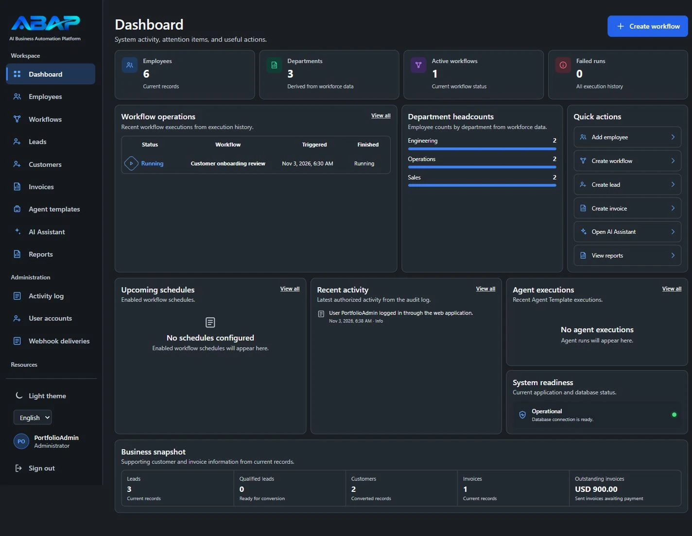
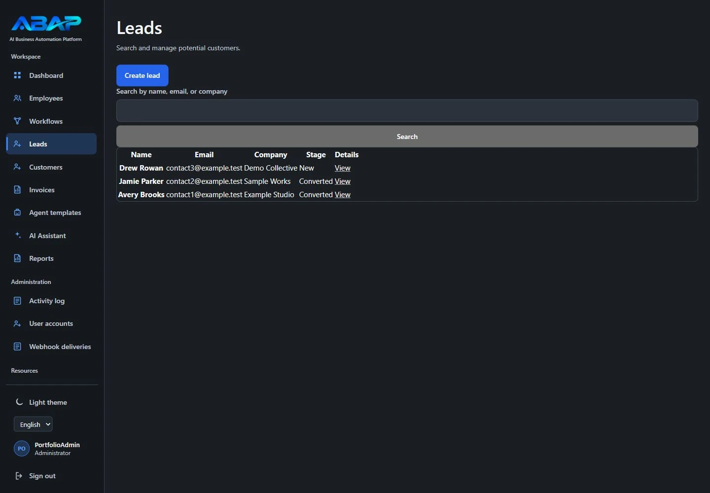
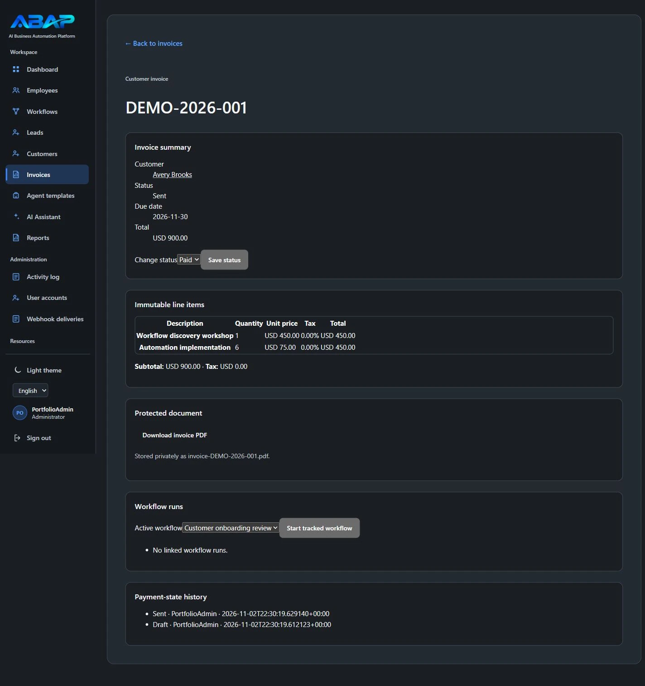
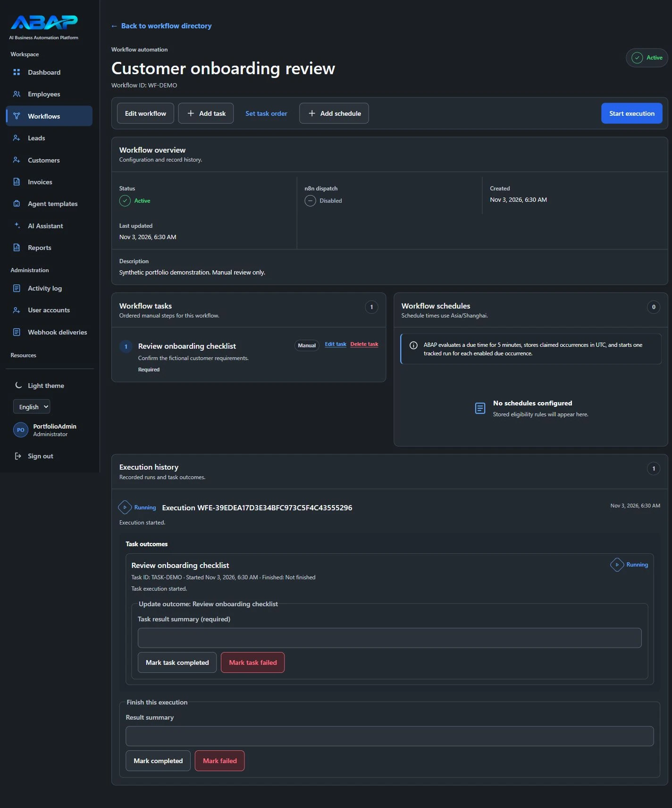
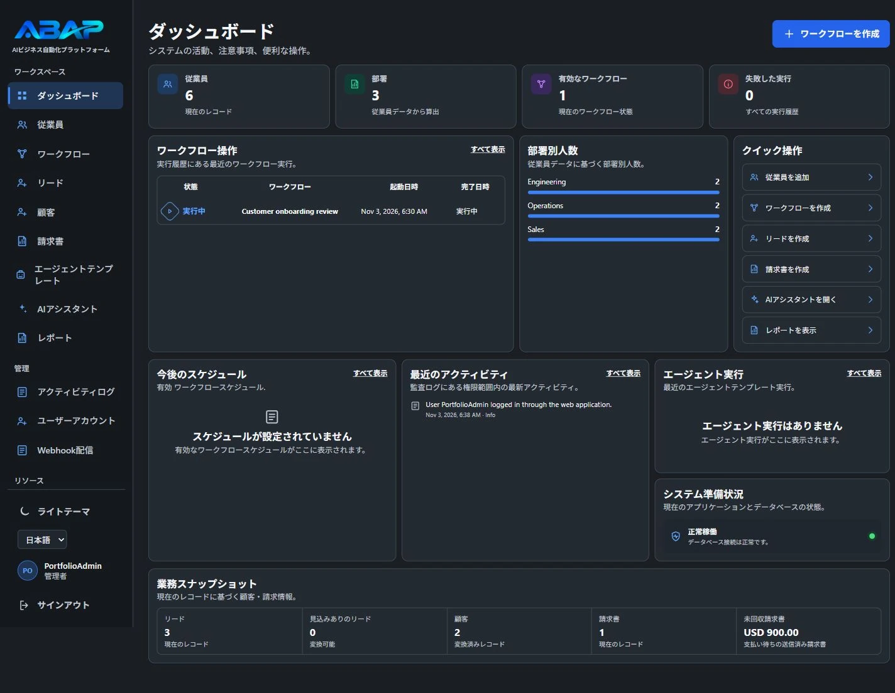
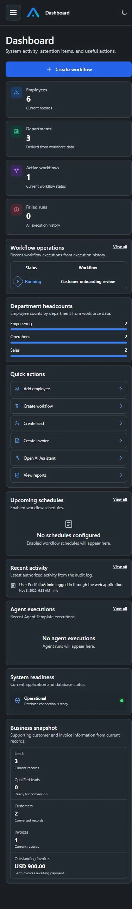
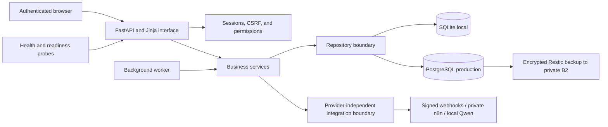

# AI Business Automation Platform Portfolio Case Study

## Project Summary

The AI Business Automation Platform (ABAP) is a tested FastAPI application for
secure business records, scheduled workflow automation, controlled AI
assistance, and recoverable operations. It combines employee management, CRM,
invoices and protected documents, role-based access, auditable execution,
PostgreSQL persistence, and provider-independent integration boundaries.

ABAP is live at [app.dennisbasadre.com](https://app.dennisbasadre.com) as a
production-hosted portfolio project. Authentication is required for protected
features; no public demo account, customers, commercial availability, or
independent security certification are claimed.

## Release evidence boundary

The earlier documentation-only update used application commit `3710f0e`. This branch now includes the later n8n integration source, synthetic-only Advanced ABAP AI Assistant and automatic validation renewal. The gallery retains its isolated synthetic capture provenance. Historical capability and operations sections below are dated evidence, not a fresh production audit; current assistant status is recorded in [the release procedure](docs/deployment/advanced-assistant-final-release-procedure.md) and [maintenance record](docs/deployment/advanced-assistant-maintenance.md). The landing page public knowledge assistant retains a separate integration boundary.

## Current Application Gallery

These genuine application captures use synthetic demonstration data in an isolated local SQLite environment, captured November 3, 2026. They are not production records or customer results. The approved Soft Graphite interface is shown without visual alteration.

### CRM leads

Fictional contacts with new and converted lead stages.

### Customer invoices

Calculated line items, a sent invoice, and a protected PDF download. All amounts are synthetic.

### Tracked workflows

An active manual workflow with a started-only execution. It remains Running; no completed automation or external dispatch is shown.

### Japanese interface

Localized interface labels with the same synthetic records. Business data and some date formatting remain English.

### Mobile responsiveness

The actual responsive dashboard at a 390 × 844 viewport. Full-page capture; the workflow table scrolls horizontally.

No AI Assistant screenshot is included because an isolated provider response has not been verified. Empty schedules and Agent execution panels reflect the actual demonstration dataset. See [screenshot provenance and privacy review](docs/portfolio/screenshots.md).

## Business Problem

Small organizations often keep business records and repeatable processes in
disconnected tools, documents, and informal checklists. That makes access
control, process consistency, execution history, integration safety, and
recovery ownership difficult to verify.

ABAP brings these concerns into one protected workspace:

- Employee, lead, customer, invoice, and protected document records
- Reusable workflows with ordered tasks, schedules, and execution history
- A dedicated worker with duplicate-safe claims, bounded retries, and recovery
- Signed integration delivery and callback records
- Provider-independent Agent Templates and a one-off AI Assistant
- English and Japanese interfaces, permissions, activity history, and probes
- Production PostgreSQL, encrypted backups, and documented recovery controls

## Demonstrable Solution

The application uses server-rendered pages with the approved responsive ABAP
design system, light and dark themes, and user-selectable English and Japanese.
Administrators manage data and controlled operations, while viewers receive
explicitly limited access. Protected requests revalidate the saved account
instead of trusting stale session identity alone.

## Engineering Highlights

### Security and data safety

- Signed, HTTP-only sessions with `SameSite=Lax`; production uses HTTPS-only
  cookies and a stable secret
- Signed-session CSRF protection for state-changing browser actions
- Default-deny permission checks and active-account revalidation
- PBKDF2 password hashing and generic authentication failures
- Parameterized database operations, foreign keys, transactions, and rollback
- Environment-backed secrets excluded from source control
- Safe public errors without database URLs, SQL details, credentials, or raw
  provider exceptions
- Success and denial activity logging for sensitive operations

### Workflow and automation design

- Draft, Active, and Inactive workflow lifecycles
- Ordered tasks with transactional resequencing and historical snapshots
- Manual, daily, and weekly schedule rules interpreted in `Asia/Shanghai`
- Duplicate-safe UTC occurrence claims and atomic eligibility checks
- Dedicated worker process with bounded retries, graceful shutdown, and
  stale-run recovery
- Stored workflow, task, delivery, callback, and Agent Execution outcomes

### Business records and documents

- Employee records, payroll views, workforce reports, and CSV export
- Lead lifecycle, notes, ownership, search, and duplicate-safe conversion
- Customer records with immutable source-lead references and CRM audit history
- Customer-owned invoices with Decimal-safe totals and immutable line items
- Private document storage with validated filenames, integrity hashes,
  permission-checked downloads, and protected generated PDFs

### Integration and AI boundary

- Versioned HMAC-SHA256 outbound and inbound webhook contracts
- Allowlisted destinations, separate signing secrets, replay protection,
  payload limits, timeouts, bounded retries, and sanitized delivery history
- A pinned private n8n Compose demonstration with no public host port
- Reusable Agent Templates and a non-persistent one-off AI Assistant
- Provider-independent adapters, including local Qwen through loopback-only
  llama.cpp and an optional OpenAI adapter
- Deterministic tests that do not require paid provider calls

The signed webhooks, n8n flow, and local Qwen provider are implemented and
privately tested. Production currently keeps selected integrations disabled;
their presence in the repository is not a claim that they are publicly enabled.

### Production, backup, and recovery

- HostHatch production deployment through Docker Compose and Caddy HTTPS
- PostgreSQL 18.6, private persistent volumes, ordered migrations, and a
  non-root application container
- `/health` process liveness and `/ready` database/schema readiness checks
- Restic encryption with a private Backblaze B2 repository boundary
- Documented backup, restore, incident, rollback, and release procedures
- Public landing page hosted independently from the application server

On October 8, 2026, a production backup and isolated recovery drill succeeded.
The encrypted Restic snapshot was verified, 22 PostgreSQL tables were restored,
application records were checked, and the disposable ABAP application passed
health and readiness checks. This is verified recovery evidence, not a claim
that every recurring-operations, monitoring, or final-release gate is complete.

## Capability Status

| Capability | Status | Evidence or boundary |
| --- | --- | --- |
| Employee management | Production-enabled | Protected employee, payroll, reporting, and export workflows |
| Leads and customers | Production-enabled | Persisted CRM screens, audit history, and duplicate-safe conversion |
| Invoices and documents | Production-enabled | Customer invoices and permission-checked protected PDFs |
| Scheduler and worker | Production-enabled | Dedicated worker, retries, stale recovery, and duplicate-safe claims |
| Execution history | Production-enabled | Workflow, task, delivery, callback, and Agent Execution records |
| English/Japanese interface | Production-enabled | User-selectable localized browser interface with English fallback |
| Health and readiness | Production-enabled | Separate `/health` and PostgreSQL/schema-aware `/ready` probes |
| PostgreSQL deployment and HTTPS | Production-enabled | HostHatch Compose deployment behind Caddy HTTPS |
| Encrypted backup and recovery | Production-tested | Restic/B2 snapshot and isolated PostgreSQL 18.6 recovery verified on 2026-10-08 |
| Signed webhooks | Implemented and privately tested | HMAC contracts, replay protection, retries, and stored metadata |
| n8n automation | Implemented and privately tested | Pinned private Compose demo; not production-enabled |
| Local Qwen through llama.cpp | Implemented and privately tested | Provider-neutral loopback adapter; kept outside public cloud deployment |
| Optional OpenAI adapter | Implemented, not production-enabled | Environment-configured provider boundary; no public availability claim |
| Recurring operations evidence | In progress | Continue observing scheduled backup, retention, and monitoring behavior |
| Final portfolio release | Planned | Final evidence consolidation, release checklist, and verified release tag |

## Completion Roadmap Status

- Milestones 1–5: complete.
- Milestone 6: complete for the approved cloud/synthetic scope; the Advanced
  Assistant is live with two selectable free models, EN/JA responses, private
  history, confirmation-protected demo interactions and automatic validation renewal.
- Milestone 7: recovery/security gates passed; corrected n8n backup files are
  installed and the recurring timer is active. Its first scheduled execution
  remains unobserved (November 5, 05:30 UTC); no new backup success is claimed.
  Restored-application startup, isolation and health checks passed November 4.
  The required vulnerability review and approved
  dependency-only production correction passed November 4.
- Milestone 8: deployed over HTTPS; the complete linked CRM/invoice/scheduled n8n
  demonstration passed in isolated Docker. The live public-flow gate remains open
  pending an explicit scope decision; production integration stays disabled.
- Milestone 9: portfolio finalization in progress; no final release tag yet.

The [November 4 final acceptance record](docs/deployment/final-platform-acceptance-20261104.md)
contains current evidence, the architecture and concise demonstration. Earlier
backup/restore proofs are retained without claiming the current full restore passed.

## Verification Evidence

- The automated suite covers services, repositories, browser routes, security
  controls, workers, integrations, domains, localization, and deployment
  boundaries; live PostgreSQL checks remain separate from ordinary local tests
- Disposable PostgreSQL 18.6 verification covers migrations and the employee,
  workflow, CRM, invoice, document, AI, and readiness paths
- The private n8n Compose demonstration completed repeated scheduled,
  signed round trips without duplicate outcomes
- Local Qwen support is exercised through the provider-independent llama.cpp
  adapter and deterministic tests without making it a public cloud dependency
- Production `/health` and `/ready` checks pass independently
- The October 8 encrypted Restic/B2 snapshot and isolated 22-table recovery
  passed application-record, health, and readiness verification

The detailed build record is preserved separately in
[`LEARNING_HISTORY.md`](LEARNING_HISTORY.md). Local run and test instructions
are in [`README.md`](README.md); production and recovery operations are in the
[deployment documentation](docs/deployment/).

## Suggested Demonstration

Use synthetic data in a local or isolated environment. Do not expose real
employee, customer, invoice, credential, or provider data, and do not create or
publish demo credentials for the production application.

1. Sign in as an administrator and explain the protected dashboard, theme, and
   English/Japanese interface controls.
2. Show employee records, workforce reporting, and permission boundaries.
3. Create a lead, convert it once, and inspect the resulting customer history.
4. Create a customer invoice, generate its protected PDF, and show the guarded
   download path.
5. Show a scheduled workflow, worker execution, task outcomes, and audit trail.
6. Explain signed webhook replay protection and run the private n8n flow only
   in its isolated demonstration environment.
7. Open the live Advanced Assistant and explain the two approved free cloud models,
   synthetic-only boundary, private history and explicit demo confirmation. Local
   Qwen remains optional and is not a production dependency.
8. Open `/health` and `/ready`, then review the October 8 recovery evidence and
   the remaining roadmap gates.

## What This Project Demonstrates

- Python application design with service and repository boundaries
- FastAPI routes, forms, sessions, templates, validation, and accessibility
- Secure role-based business operations and auditable state changes
- SQLite and PostgreSQL integration with repeatable migrations
- Background workflow execution and concurrency-aware occurrence claims
- Replay-resistant signed integration contracts and private n8n automation
- Provider-independent AI with deterministic tests and isolated local Qwen
- Bilingual interface delivery with complete request-scoped localization
- Reproducible container deployment, encrypted backups, and tested recovery
- Evidence-based communication that separates production-enabled, implemented,
  privately tested, in-progress, and planned capabilities

## Next Development Priorities

1. Record the remaining recurring backup, retention, monitoring, and alerting
   evidence without overstating one successful drill as the entire operations
   milestone.
2. Close the remaining Milestone 8 acceptance boundary before enabling
   any selected production integration.
3. Consolidate current screenshots, architecture, test evidence, operational
   records, and troubleshooting guidance for Milestone 9.
4. Tag a final verified portfolio release only after every advertised exit gate
   is satisfied.
