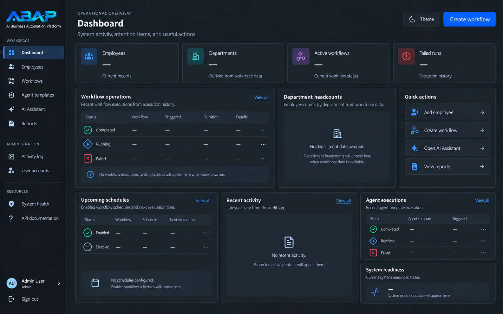

# AI Business Automation Platform

ABAP is a Python business-automation portfolio application. It brings employee
operations, CRM records, invoices and protected documents, repeatable
workflows, role-controlled administration, and optional AI-assisted work into
one protected web workspace. The application is live at
[app.dennisbasadre.com](https://app.dennisbasadre.com), but it remains a
portfolio project: no customers or commercial availability are claimed.



*Current dashboard design proposal, using synthetic portfolio content.*

## Source and evidence boundary

This documentation-only candidate is based on application commit
`3710f0eaf28c4ea8200a4e2072810e24662b7105`. It does not include the later
n8n integration release `7c307c17`. Screenshots were captured from the newer
isolated application working copy identified in the screenshot evidence;
they are not captures of this older runtime checkout. Deployment and capability
statuses summarize recorded project evidence, not a fresh production audit.
The later n8n release and its preflight documents are outside this candidate.

## The problem it explores

Small teams often run people data and recurring processes through spreadsheets,
documents, and informal checklists. ABAP explores a safer, more accountable
approach: controlled employee access, reusable workflows with execution
history, and explicit boundaries around AI and external integrations.

## Major capabilities

- Employee directory, profiles, payroll views, workforce reporting, and CSV
  export, backed by SQLite locally and PostgreSQL for the Compose package.
- Role-based administrator and viewer access, signed sessions, CSRF protection,
  activity logging, and safe browser error handling.
- Workflow definitions, ordered tasks, lifecycle controls, manual executions,
  stored schedules, duplicate-safe occurrence claims, and a dedicated
  background worker with bounded retries and stale-run recovery.
- CRM leads and customers, duplicate-safe lead conversion, customer-owned
  invoices, immutable line-item snapshots, and protected PDF documents.
- Agent Templates and a one-off AI Assistant behind a provider boundary. The
  optional OpenAI adapter is configured through the environment; tests use
  deterministic providers and do not require paid API calls.
- HMAC-signed inbound and outbound webhooks, a private n8n demonstration, and
  provider-independent local Qwen support through loopback-only llama.cpp.
  These integrations are implemented and privately tested, but disabled in
  production.
- Health (`/health`) and database-readiness (`/ready`) endpoints, with a
  production Docker Compose deployment.
- User-selectable English and Japanese browser interfaces with signed-session
  and authenticated-account preference persistence and English fallback.
- Encrypted production backups through Restic and private Backblaze B2 storage,
  with documented restore and rollback procedures.

For the detailed implementation boundary and planned work, see the
[portfolio case study](PORTFOLIO.md).

## Architecture and technology

```text
Browser
  -> FastAPI + Jinja templates
  -> authorization, CSRF, and service boundaries
  -> repositories
  -> SQLite (local) / PostgreSQL (production)
Worker
  -> scheduled workflow claims and execution history
Private/test integrations
  -> HMAC webhooks / n8n / loopback llama.cpp + Qwen
```

The stack includes Python, FastAPI, Jinja2, SQLite, PostgreSQL, Psycopg,
ItsDangerous signed sessions, gettext/Babel, HTML/CSS/JavaScript, Docker
Compose, n8n, HMAC-signed webhooks, Restic, Backblaze B2, llama.cpp, Qwen, and
an optional OpenAI integration.

## Engineering and security practices

- Default-deny permissions and active-account revalidation for protected work
- PBKDF2 password hashing, generic authentication failures, and signed
  HTTP-only sessions
- CSRF checks for state-changing browser actions
- Parameterized database access, transactions, and migration tracking
- Activity records for sensitive successes and denials
- Environment-backed secrets excluded from Git; no real secrets or production
  data are needed to run the automated unit suite

These are implementation and operational practices, not a claim of independent
security certification.

## Run locally

Use Python with the application dependencies installed. From the repository
root, create a virtual environment and start the FastAPI application:

```powershell
python -m venv .venv
.\.venv\Scripts\python.exe -m pip install -r Projects\employee_management_system\requirements.txt
.\.venv\Scripts\python.exe -m fastapi dev Projects\employee_management_system\web_app.py
```

Open `http://127.0.0.1:8000/` for the web UI, `/health` for liveness, `/ready`
for database readiness, and `/docs` for the generated API documentation. The
interactive console can be started with:

```powershell
python Projects\employee_management_system\main.py
```

## Test

From the application directory:

```powershell
Set-Location Projects\employee_management_system
python run_tests.py
```

The repository includes unit coverage for application services and focused
deployment/integration boundaries. Live PostgreSQL checks require a disposable
database and are intentionally separate from ordinary local tests. Continuous
integration runs the same suite on Python 3.12 after installing the declared
requirements. It supplies no credentials, Docker services, or external
infrastructure, so live PostgreSQL and real-provider verification remain out
of scope for that workflow.

## Deployment status

The PostgreSQL-backed application is deployed on HostHatch through Docker
Compose and Caddy HTTPS. The production web service and worker use migrations,
persistent private data volumes, readiness checks, secure cookies, and a
non-root application container. Protected-workflow integrations and local Qwen have separate deployment gates;
private demonstration evidence does not establish public availability. The
landing page public knowledge assistant is a separate integration, preserved
by the landing release and not live-verified in this documentation review.

On October 8, 2026, a production Restic backup to private Backblaze B2 storage
and an isolated PostgreSQL 18.6 recovery drill succeeded. The encrypted
snapshot was verified, 22 tables were restored, application records were
checked, and the disposable ABAP application passed `/health` and `/ready`.
This proves the recorded backup and recovery path; it does not by itself mark
every production-operations or cloud-deployment roadmap gate complete.

See the [Compose deployment runbook](docs/deployment/compose-deployment-runbook.md)
and [environment configuration contract](docs/deployment/environment-configuration.md).

## Documentation

- [Portfolio case study and honest roadmap audit](PORTFOLIO.md)
- [Architecture documentation](docs/architecture/)
- [Security and provider contract](docs/security/openai-provider-contract.md)
- [Deployment documentation](docs/deployment/)
- [Design specification](docs/design/approved-ui-ux-specification.md)
- [Safe n8n workflow example](examples/n8n/abap-signed-workflow.json)
- [Learning-history separation](LEARNING_HISTORY.md)

## Project status and learning story

ABAP is an actively developed, production-hosted portfolio project, not a
finished commercial platform. Completion-roadmap Milestones 1–5 are complete.
Milestone 6 connections are implemented and privately tested but remain
disabled in production. Milestones 7–8 remain in progress while their remaining
operations, monitoring, integration, and release gates are completed; Milestone
9 has not started. The detailed build journey has been preserved in a separate
learning-history export so this repository can stay focused on the product and
its engineering evidence.

The project was built as a deliberate learning journey. That context is kept
visible without conflating the product repository with hundreds of daily notes;
see [LEARNING_HISTORY.md](LEARNING_HISTORY.md) for the retained summary and
separation plan.
