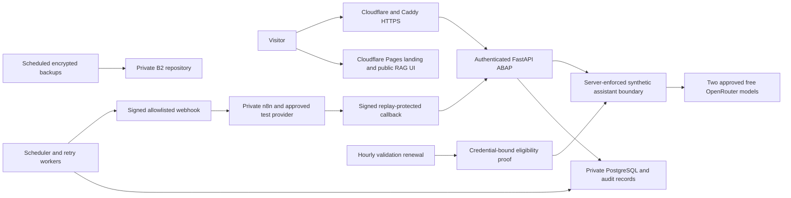

# ABAP final acceptance — November 4, 2026

This is the current completion record. Historical preflight NO-GO statements do
not undo the separately approved synthetic assistant deployment. Unfinished gates
below are not represented as passed. No final release tag has been created.

## Delivered scope and reused evidence

| Milestone | Delivered evidence | Remaining exit condition |
| --- | --- | --- |
| 6 — Selected External Connections | Two approved OpenRouter free cloud models passed authentication, EN/JA, structured business JSON and manual switching. The authenticated synthetic-only assistant is live. Signed ABAP–n8n scheduled round trips, replay protection, timeout/retry handling and stored execution/delivery outcomes passed in isolation. Provider contracts, scopes, failure handling and rotation instructions exist. | The owner's cloud-only correction supersedes laptop Qwen as a required production dependency. Qwen remains an optional local adapter; GoHighLevel remains conditional/deferred. Neither is advertised as production-enabled. The selected connection gate is satisfied for this approved scope. |
| 7 — Production Operations | Encrypted image/configuration preservation and authenticated PostgreSQL dump parsing passed. Both n8n offline restores, SQLite integrity and credential decryption passed. Daily ABAP backup completed November 4 at 02:16:01 UTC, success/exit 0. Operations, retention and full-check services report success. | Finish the existing isolated ABAP restored-database-to-healthy-application continuation and document its rollback evidence. Qualify the recurring n8n backup service before enabling its timer: current service is failed, timer disabled, protected prior staging must be preserved. Complete the roadmap's dependency/container vulnerability review; no clean scan is claimed. |
| 8 — Cloud Deployment and HTTPS | Production ABAP and HTTPS are live. Web-only replacement preserved data/history and other containers. Health/readiness/login returned 200. Migrations 001–016 and private n8n/RAG configuration were preserved. | Consolidate evidence that the final scheduled signed n8n flow is displayed through the HTTPS application and linked to the existing CRM/invoice demonstration. Do not enable integrations globally or alter real workflows just to claim this gate. |
| 9 — Final Portfolio Release | Existing README, portfolio, genuine synthetic screenshots, architecture/contracts, deployment/incident/recovery guidance and demonstration below are available. Prior PostgreSQL regression snapshots (896, later 907/928), focused security/isolation tests and live provider checks are reused, not rerun. | Close the outstanding gates above, synchronize appropriate source/docs, then tag the verified release. Do not call an accepted disaster-recovery risk a successful restore. |

## Production status read November 4

At 10:26:42 UTC (18:26:42 Shanghai):

- The naturally scheduled daily ABAP backup ran 02:15:31–02:16:01 UTC and succeeded.
- The automatic validation timer was enabled/active; latest service execution
  10:01:31–10:01:32 UTC succeeded. No forced provider probe was run.
- Operations, backup maintenance and full-check services reported success/exit 0.
  An inactive oneshot service is not evidence that its timer is disabled.
- `n8n-backup.service`: failed, `Result=exit-code`; `n8n-backup.timer`: inactive/disabled.
  No job or timer was started. Prior one-off backup/recovery evidence remains valid.
- Automated SSH does not have authenticated sudo. No password was requested.

Backblaze Caps & Alerts was read through the owner's authenticated browser:
24/2,500 Class B, 24/2,500 Class C, 34 KB/1 GB download. Caps were not changed.
The recovery command must bind a fresh observation and retain its 15-minute
admission deadline; elapsed daily reset alone is insufficient.

## Exact remaining application recovery operation

Reuse `retrieve-and-continue-application-once.py` and its successful private Docker
runtime. Only its running-production image admission was updated after deployment:
current web `bd33abea…` is distinct from restored rollback image `e9b09e43…`.
The restore inputs and runtime remain pinned. Three new local admission tests
passed; no backup, repository scan, startup diagnostic or recovery drill was repeated.

- Configuration: snapshot
  `a6cf741f6bc5cdeaf0016b698bf77b0f651ffbb521c760796869418953a5a848`,
  `/application-configuration.tar`, 61,440 bytes, SHA-256
  `2281312dbb691abe693dfb2467361e951624c840654c126bbe64958c76e5d0d8`.
- Database: snapshot
  `ac2dae86ca8f5106bfcb4c08a57aa8e1afec77496ab0cfb3e010fd087cd55e45`,
  `/var/backups/abap/staging/database.dump`, 72,058 bytes, SHA-256
  `25839dda140bcf066cc687296a2a1fb45d52239e84827a549635f975f9de5761`.
- Reuse cached exact rollback image; no image download. Two exact Restic dump
  operations only, existing cache/caps, no repository listing/check/prune/backups.
- Restore only into disposable PostgreSQL 18; baseline migrations 001–013.
  Start recovered web with fresh isolated credentials/read-only role, no outbound
  route, published ports, integrations, jobs or production volume mounts.
- Verify restored database integrity, application startup, health/readiness/login,
  independent production comparisons and identity-verified disposable cleanup.
- No automatic retry. Stop on expired quota proof, drift, integrity, resource or
  isolation failure. Existing consumed receipts and protected staging remain intact.

This verifies the preserved rollback baseline, not later application writes,
proxy/TLS rebuilding, full-host recovery or invoice/log payload restoration.

## Concise final demonstration

Use isolated synthetic CRM/invoice records and existing private test-provider
configuration. Never submit real business data to the free models.

1. Show HTTPS/login, administrator permissions and English/Japanese interface.
2. Show a synthetic lead, its one-time customer conversion and audit history.
3. Show that customer's synthetic invoice, protected PDF and linked workflow.
4. Show the approved workflow/tasks/schedule persisted in PostgreSQL.
5. Show the worker's single occurrence claim and signed outbound delivery.
6. Show private n8n's approved synthetic action and signed result callback.
7. Show task/execution/delivery outcomes and duplicate/replay evidence in ABAP.
8. Open the deployed Advanced Assistant, select either approved free model, show
   existing EN/JA synthetic results/private history and a confirmed isolated demo
   interaction. Existing successful smoke evidence may be replayed in the portfolio.
9. Show the backup/recovery receipts and final acceptance matrix, explicitly
   distinguishing verified restores from remaining recovery limitations.

The script describes the complete review flow. Its linked production scheduled
automation acceptance is not marked executed until the corresponding evidence exists.

## Current architecture

## Selected-provider rotation and failure handling

OpenRouter rotation is an operator-approved maintenance action: create a scoped
replacement with the same $0 limit, install it only through the existing protected
server-side file mechanism, and explicitly validate the same two free model IDs
with synthetic probes. Replace the credential-bound proof atomically. Recreate
only web if the existing individual-key bind retains the old inode; preserve all
other environment and mounts. Verify admission before revoking the superseded
key. Do not print key bytes or allow stale proof to authorize the replacement.
Hourly renewal does not rotate credentials or broaden the model allowlist.

For the private signed n8n demonstration, rotate the outbound/inbound HMAC secrets
and provider token only in a separately approved coordinated maintenance window
using the existing secret files; update their corresponding authorized endpoints,
verify one synthetic round trip, then retire old values. Never weaken signature,
replay, allowlist or ownership checks to complete rotation. Existing timeout,
retry/outbox, callback and failure-translation tests are retained as evidence.
Provider quota failures offer manual free-model selection; no paid fallback.

## Approval boundaries

No production service, workflow, database, timer, credential or spending cap was
changed during this completion preparation. The previously approved isolated
recovery still requires authenticated sudo and a fresh capacity proof. Recurring
n8n installation/qualification/activation needs a concrete separately approved
operation; the failed legacy wrapper must not simply be enabled.

Automatic approval review rejected running Docker Scout against the private image
because package/image metadata may be sent to Docker's service. No scan ran and
no report is claimed. Approval for that specific metadata egress, or an available
offline vulnerability database, is required to complete the existing review gate.

The landing-page assistant section is locally implemented in its separate
repository. Publishing it still requires the owner's review approval. Its public
RAG checks passed; visual verification was blocked by the browser tooling.
